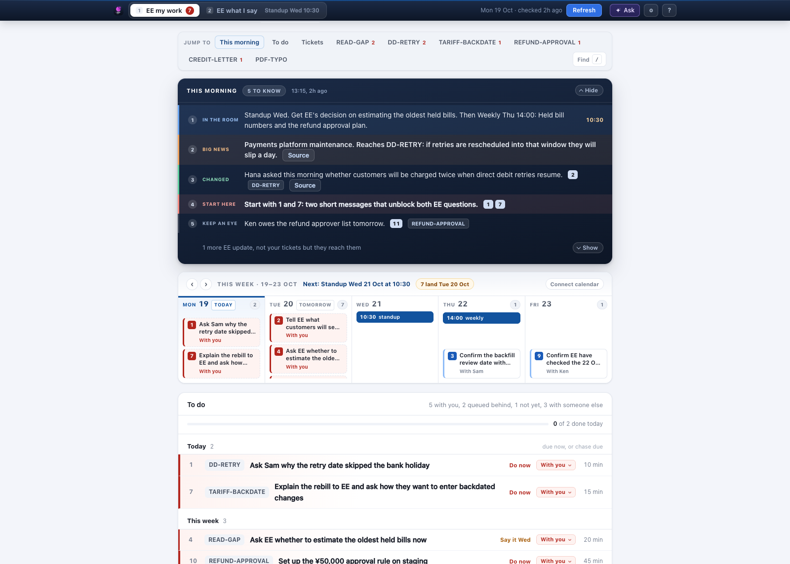
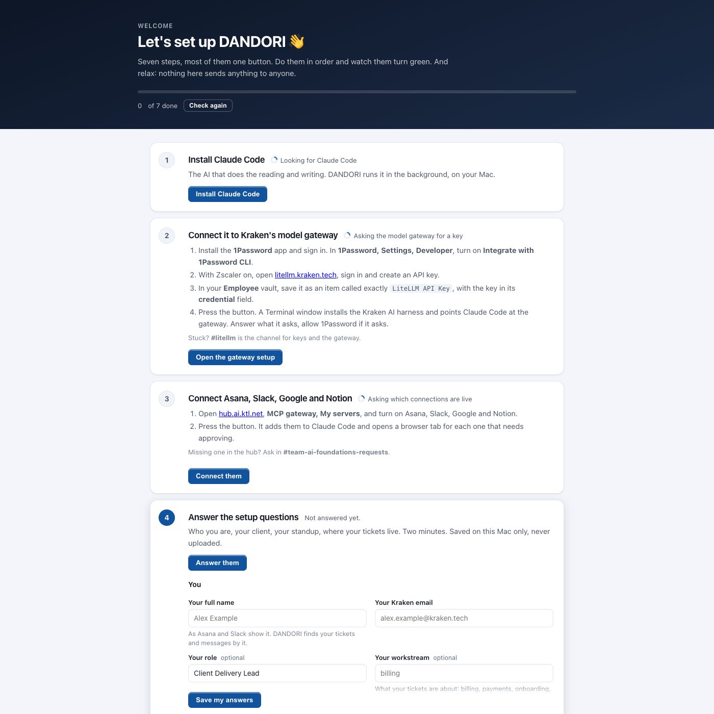

# DANDORI

**Your tickets aren't the problem. Reading them every morning is.**

**[Install](#-install) · [Setup](#-setup) · [Chat](#-chat-with-dandori-optional) · [When it breaks](#-when-it-breaks) · [How it works](#-how-it-works-properly)**

Why a Japanese name? **DANDORI** (段取り) means lining up the work before you
start it. Ask anyone with a Japanese client and they'll tell you that's most of
the job.

I built it because I was losing the first hour of every day to Asana and Slack,
just to find out what I owed whom. So I made the computer do it.

It's a to-do list for Kraken CDLs that keeps itself. Press **Refresh** and it
reads Asana, Slack, your calendar and your meeting notes, then tells you only
what changed. Press **Write prep** and it writes what you'll say at your next
standup.

And it never sends anything. Every reply is a draft you post yourself, because
the day an AI posts to your client by mistake is not a day you want to have.



**What you get**

- 📋 **One numbered list.** Every Asana ticket assigned to you, with its Slack
  threads. "Do 4" means the same job next week, and every job says who holds it.
- ✍️ **Replies already drafted.** In the client's language for the client, in
  English for Kraken.
- 🎤 **Your standup script.** Written before the meeting, and the notes folded
  back in after it.
- 💬 **An Ask box on every job.** "Why is this waiting", "rewrite this more
  plainly", "this is with Sam now". It does what you say.

---

## 🚀 Install

**Before you start**, check you have:

- [ ] A Kraken Mac with **Zscaler** on
- [ ] **1Password**, signed in
- [ ] Access to the **Kraken AI Hub** ([hub.ai.ktl.net](https://hub.ai.ktl.net) opens)

Set aside about 20 minutes. Most of it is approving logins ☕

### Option A: Open the Mac App (`.dmg` or `.pkg`) — no Terminal needed

1. Download **`DANDORI.dmg`** (or **`DANDORI.pkg`**) from [Releases](https://github.com/KonichiValue/DANDORI/releases) or your team's Slack channel.
2. Open `DANDORI.dmg` and drag **DANDORI** into **Applications** (or double-click `DANDORI.pkg`).
3. Open **DANDORI** from Applications or your Dock. It sets up `~/Projects/DANDORI` automatically and opens the setup page in your browser.

### Option B: One line in Terminal

If you'd rather skip the download:

1. Press `⌘ Space`, type *Terminal*, press Enter.
2. Paste this line and press Enter:

   ```bash
   curl -fsSL https://raw.githubusercontent.com/KonichiValue/DANDORI/main/bootstrap.sh | zsh
   ```

3. Wait for the setup page to open in your browser. A **DANDORI** app is now in your Applications folder too, so drag it to your Dock.

---

## ✅ Setup

The setup page walks you through everything with one button per step, and each step turns green automatically when it's done.



1. **Install Claude Code.** Press the button. Claude Code is the AI that does the reading and writing on your Mac.
2. **Connect it to Kraken's model gateway.** Create a key at [litellm.kraken.tech](https://litellm.kraken.tech) and save it in 1Password (`Employee` vault, item named `LiteLLM API Key`, field `credential`). Press the button and answer what the Terminal window asks; the setup page updates itself when Terminal finishes.
3. **Connect Asana, Slack, Google and Notion.** Turn all four on at [hub.ai.ktl.net](https://hub.ai.ktl.net) under **MCP gateway, My servers**. Press the button and approve each browser tab that opens.
4. **Answer the setup questions.** Your name, email, timezone and model region are pre-filled from your Mac. Type your **Client name** (which auto-fills the short name, terminal command and standup name), paste your Asana project link, and press **Save my answers**.
5. **Teach it your house style** *(optional, but worth it)*. Claude interviews you for ten minutes so your drafts sound like you.
6. **Install the app.** Already green if you used `DANDORI.dmg` or `install.sh`.
7. **Build your board.** Press **Run the first refresh**. It reads everything assigned to you in Asana and Slack (5 to 10 minutes — go grab that coffee).

**You're done 🎉** From now on, every morning:

1. Open DANDORI and press **Refresh**.
2. Work down the list. When you've posted a reply, press **Posted it**, and the job waits on whoever owes you an answer.
3. Before your standup, press **Write prep**.

To change an answer later: **Settings, Open the setup page**. Everything specific to your client lives in `clients/<client>/` (`config.json`, `profile.md`, `scripts/`, `docs/`, `state/`), which git never uploads 🔒

**Stuck on a step?** Ask in **#claudecode-help** for Claude Code, **#litellm** for the gateway key, **#team-ai-foundations-requests** for a server missing from the AI Hub.

---

## 🗂️ How the folder is structured (`core/` + `clients/`)

DANDORI is split like Kraken into a shared **Core** (`core/`) and a gitignored **Client workspace** (`clients/<client>/`):

- **`core/`** holds the engine, local page server, renderers, agent runner, security guards and prompts. Every CDL runs the same `core/`.
- **`clients/<client>/`** holds everything specific to your client and workflow:
  - `config.json` and `profile.md`: your settings and house-style playbook.
  - `plugin.py`: optional Python hooks for client-specific board and audit checks.
  - `scripts/`: your client workflow scripts (`DANDORI scripts` lists them, `DANDORI run <name>` runs one).
  - `docs/`: client documents, handovers, sheets and PDFs.
  - `state/`, `output/`, `logs/`: your board, asks, calendar and rendered pages.

---

## 💬 Chat with DANDORI (optional)

A chat lets you talk to your whole board at once, which is handy when the Ask box on one job isn't enough: planning across three jobs, arguing with a draft, pasting in a client's email, or reading code together. You don't need it for the daily routine above.

**The easy way: Claude Desktop.** You probably have it already. If not, [download it](https://claude.ai/download) and sign in.

1. Open the **Code** tab and press **Select folder**.
2. Pick `~/Projects/DANDORI`.
3. Type `refresh`, `prep`, `do 4` or `draft the reply to 12`.

**Prefer a terminal?** `cd ~/Projects/DANDORI && claude` (or `DANDORI chat`) does the same.

Either way it's the same board and the same rules as the buttons. **Copy for a chat** on any Ask box hands that job over with your question.

> **One catch.** The buttons on the DANDORI page run Claude Code in the background, with its own logins, separate from Desktop's. So do setup steps 1 and 3 even if Desktop already has Asana. If a *button* says a login lapsed, press **Connect them** on the setup page.

## 🔧 When it breaks

| You see | Do this |
|---|---|
| `Permission denied (publickey)` when you paste the install line | Use `DANDORI.dmg` instead. |
| *Asana* or *Slack* "needs authentication" | Open the setup page and press **Connect them** again. |
| A credential or 1Password error | Unlock 1Password and press **Refresh** again. Still failing? Redo setup step 2. |
| `UNKNOWN_CERTIFICATE_VERIFICATION_ERROR` | Zscaler signing in again. Give it a minute. |
| The model is not found | Your LiteLLM region is probably wrong (eu, us or apac). Check it in the setup questions against [hub.ai.ktl.net/models](https://hub.ai.ktl.net/models). |
| The app won't open | Run `~/Projects/DANDORI/install.sh` in Terminal. |
| Anything else | Run `~/Projects/DANDORI/core/check.py` (or `DANDORI check`). It tells you what's wrong. Then ask in **#claudecode-help**. |

## 📦 Packaging for another Mac

To build a standalone `.dmg` disk image, `.pkg` installer and `.zip` archive in `dist/` that another CDL can install on their Mac like any downloaded app:

```bash
DANDORI package
```

It runs `./core/check.py` first and verifies that zero personal files or client workspaces (`clients/<client>/`) are included in the bundle.

## 🔄 Getting the latest

```bash
~/Projects/DANDORI/bootstrap.sh
```

It pulls the newest version and reinstalls. Your answers, board, profile and client scripts in `clients/` are never touched. `DANDORI version` prints which release you are on.

<details>
<summary><b>🧰 The whole setup by hand</b>, in case a button sulks</summary>

Run these inside `~/Projects/DANDORI`.

1. **Claude Code:** `curl -fsSL https://claude.ai/install.sh | bash`, open a new Terminal window, check with `claude --version`.
2. **The model gateway:**
   1. In 1Password, open **Settings, Developer** and turn on **Integrate with 1Password CLI**.
   2. Create a key at [litellm.kraken.tech](https://litellm.kraken.tech) and save it in your **Employee** vault, in an item called exactly `LiteLLM API Key`, in its **credential** field.
   3. No Kraken command line yet? `brew install octoenergy/tap/kraken-cli`.
   4. `kraken ext install ai-harness`, then `kraken ai-harness setup-claude-code`.
   5. `claude --print hello` should answer.
3. **Asana, Slack, Google and Notion:** turn them on at [hub.ai.ktl.net](https://hub.ai.ktl.net), run `./core/scripts/setup-mcp.sh`, approve each browser tab.
4. **The questions:** `./core/setup.py`. [core/setup/QUESTIONS.md](core/setup/QUESTIONS.md) explains each one.
5. **Your house style:** `claude 'follow core/setup/INTERVIEW.md'`, or edit `clients/<client>/profile.md` yourself from [core/setup/profile.example.md](core/setup/profile.example.md).
6. **The app:** `./install.sh`.
7. **The first refresh:** `bin/DANDORI refresh`.

</details>

---

## 🧠 How it works, properly

[GUIDE.md](GUIDE.md) goes through the board, the script, the standup fold-in, the Ask box and every piece of the code. [AGENTS.md](AGENTS.md) is the rulebook every AI in this folder has to follow.

## 📜 The rules it never breaks

- **It never sends anything.** Slack, Asana, Notion and email are read only.
- **Your board is yours.** A ticket shows up only because Asana assigns it to you, and a job keeps its number until you close it.
- **Nothing internal reaches the client.** Story points, build-queue position, internal links and engineer names stay out of anything addressed to them. Ask me how I know.
- **Nothing personal is ever committed.** Your answers, profile, scripts and board live in `clients/<client>/`, which git ignores.
