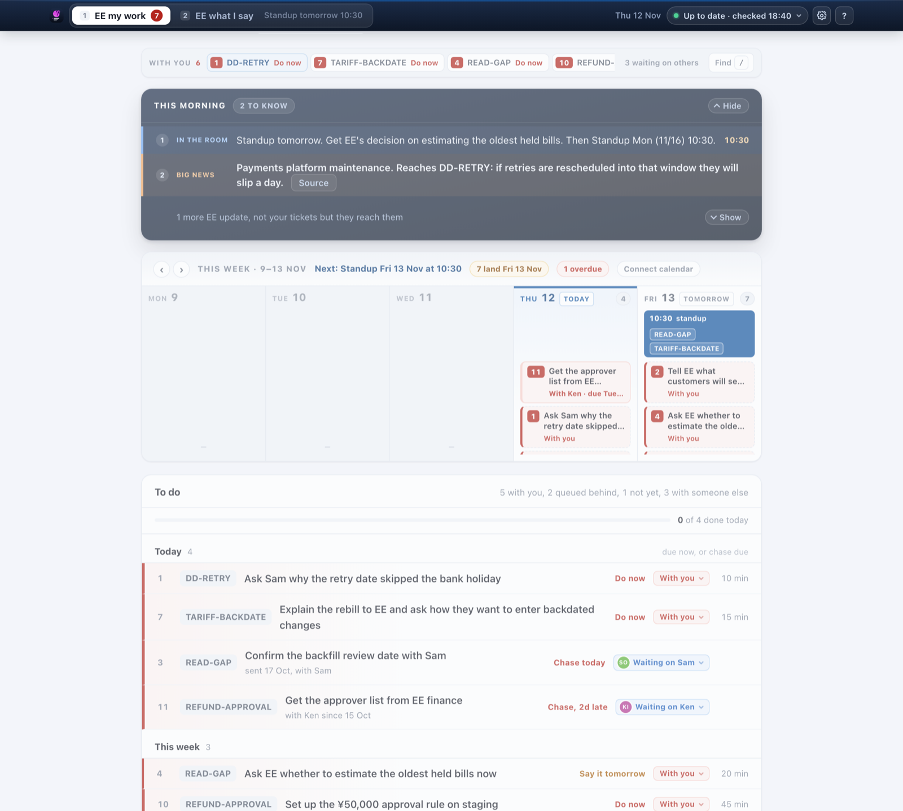
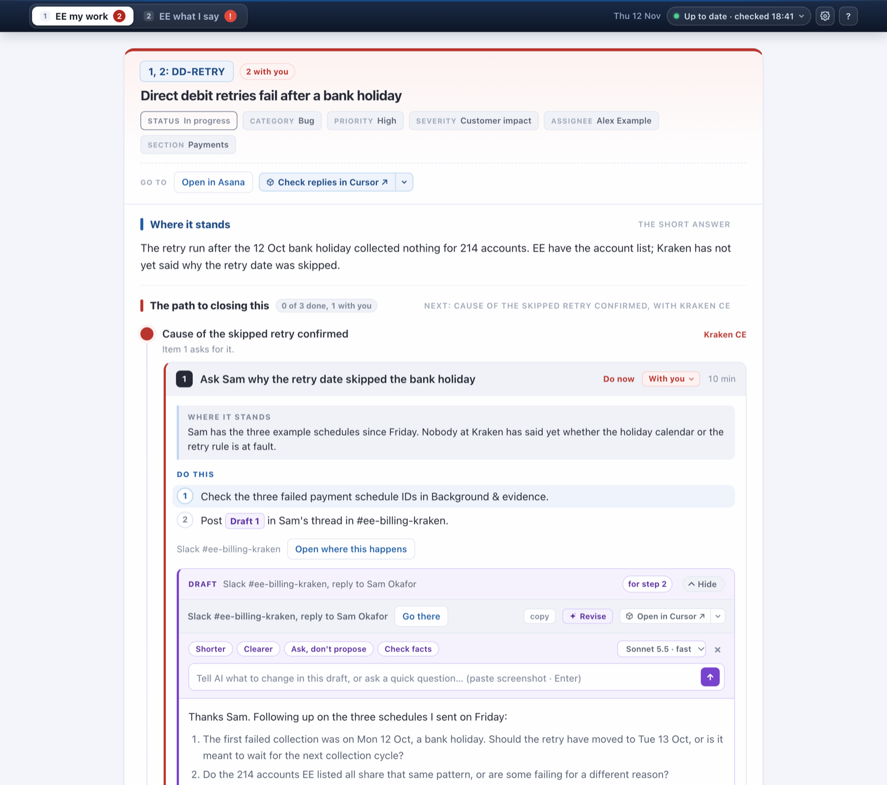
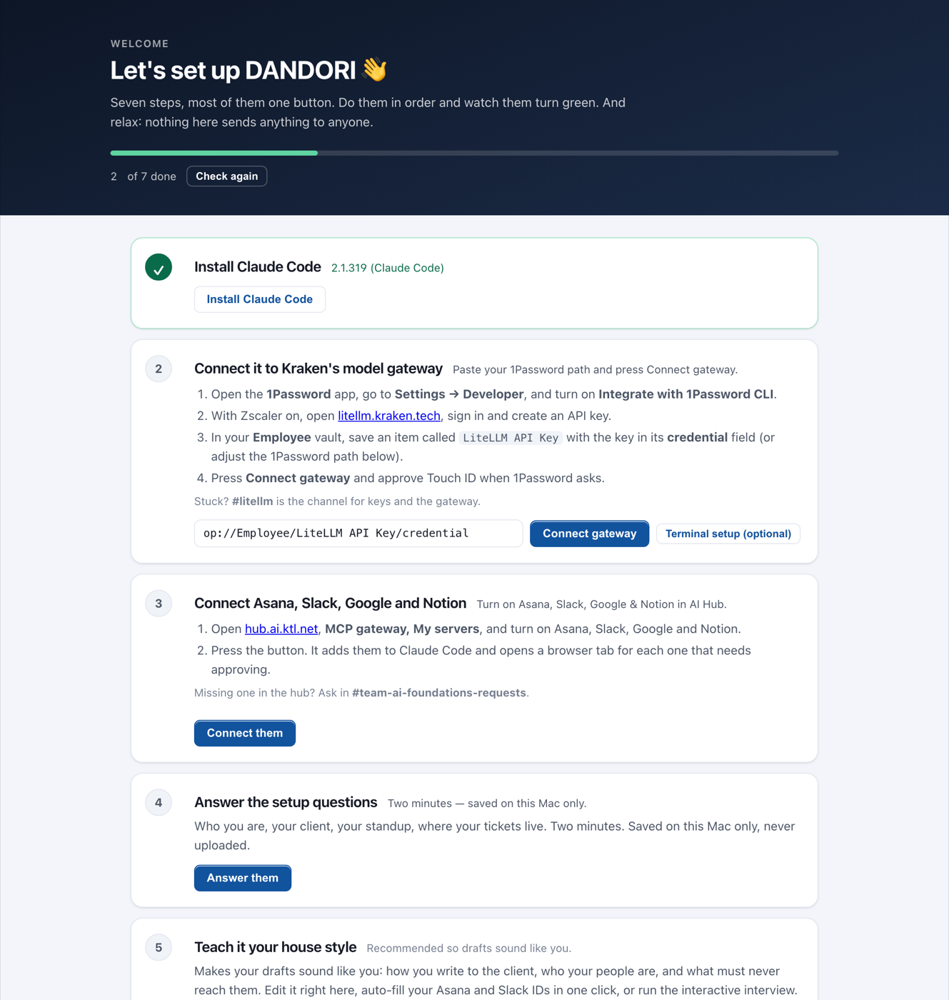

# DANDORI (段取り)

**Your tickets aren't the problem. Spending the first hour of every morning playing detective across Asana and Slack is.**

**[Install](#-install) · [Setup](#-setup) · [Cursor & Claude](#-cursor--claude) · [When it sulks](#-when-it-sulks)**

**DANDORI** (段取り) is Japanese for lining up the work before you start it. Ask anyone with a Japanese client and they will tell you that is 80% of the job.

It is a self-updating desk for Kraken CDLs. It quietly checks Asana, Slack, Google Calendar, and meeting notes in the background, drafts your replies in your own voice, writes what you say at standup, and keeps every job on one permanent number until it closes.

And **it never sends a message**. Every reply waits for your own finger on the keyboard, because "sorry, my robot replied to the client" is not a career milestone.



### What you actually get

- **Auto-sync without button mashing.** A cheap Haiku scout checks Asana and Slack every 15 minutes on weekdays (and right after you post a reply), running a delta update only when something moved.
- **Drafts ready to paste, with instant `✦ Revise`.** Client language for the client, English for Kraken. Need it shorter or softer? Click **`✦ Revise`** right on the draft for a 4-second in-place edit with 1-click **`↺ Undo`**.
- **Seamless Cursor, Claude Code & Claude Desktop.** Click **`Open in Cursor ↗`** (or hit **`▾`** to switch to **Claude Code** or **Claude Desktop**) and your interactive DANDORI board opens inside chat at that exact ticket, job, and draft.
- **Your standup script.** Written in your house style before the room, with meeting notes folded back into the board after it ends.
- **Automatic Asana Status on your tickets.** When a ticket is assigned to you and the work moves forward, DANDORI updates its Asana Status dropdown so you don't forget.



---

## 🚀 Install

Check three things first:
- [ ] Kraken Mac with **Zscaler** connected
- [ ] **1Password** app signed in
- [ ] Access to **[hub.ai.ktl.net](https://hub.ai.ktl.net)**

Grab a coffee (~15 minutes, mostly clicking "Approve" in browser tabs).

### Option A: Drag-and-drop Mac App (zero Terminal)

1. Download **`DANDORI.dmg`** (or **`DANDORI.pkg`**) from [Releases](https://github.com/KonichiValue/DANDORI/releases) or Slack.
2. Drag **DANDORI** into **Applications** and open it.
3. It sets up `~/Projects/DANDORI`, wires up Cursor and Claude automatically, and opens the setup page in your browser.

### Option B: One line in Terminal

```bash
curl -fsSL https://raw.githubusercontent.com/KonichiValue/DANDORI/main/bootstrap.sh | zsh
```

---

## ✅ Setup

One page, seven green ticks, zero guesswork.



1. **Install Claude Code.** Click the button.
2. **Connect Kraken's model gateway.** Turn on **Integrate with 1Password CLI** in `1Password -> Settings -> Developer`. Create a key at [litellm.kraken.tech](https://litellm.kraken.tech), save it in your `Employee` vault as `LiteLLM API Key` (field `credential`), and click **Connect gateway**.
3. **Connect Asana, Slack, Google & Notion.** Enable all four at [hub.ai.ktl.net](https://hub.ai.ktl.net) (**MCP gateway -> My servers**), then click **Connect them** and approve each browser tab.
4. **Answer the setup questions.** Type your client's name, paste your Asana project link, and click **Save my answers**.
5. **Teach it your house style.** Edit your playbook right on the page (and click **Auto-fill Asana & Slack IDs**).
6. **Install the app.** Already green if you used the `.dmg` or `install.sh`.
7. **Build your board.** Click **Run the first refresh** (5 to 10 minutes while it reads your open world).

Your client settings, house style, scripts, and board live in `clients/<client>/`, which git ignores completely.

---

## ⚡ Cursor & Claude

`install.sh` registers DANDORI's **MCP App** (`ui://dandori/board`) and the **`/dandori`** slash command across **Cursor**, **Claude Code**, and **Claude Desktop** automatically.

- **From DANDORI:** Click **`Check replies in Cursor ↗`** on any ticket or **`Open in Cursor ↗`** on any draft. Click **`▾`** to switch your default to **Claude Code** or **Claude Desktop** anytime.
- **From any chat:** Type **`/dandori`** (or **`/dandori 42`**) to pop open your live interactive board inside the conversation, pin context with one click, and tick steps or drafts in place.

---

## 🔧 When it sulks

| You see | Do this |
|---|---|
| `Permission denied (publickey)` on `git clone` | Use `DANDORI.dmg` instead, or use the HTTPS `bootstrap.sh` command above. |
| *Asana* or *Slack* needs sign-in | Click the sync pill in the header and press **Sign in** next to Asana & Slack. |
| Database replica expired | Click the sync pill and press **Log in** next to Database replica. |
| 1Password / credential error | Unlock 1Password and try again. Still stuck? Check step 2 on `/setup` (**#litellm**). |
| `UNKNOWN_CERTIFICATE_VERIFICATION_ERROR` | Zscaler is doing yoga. Give it 60 seconds to reconnect. |
| Anything else | Run `DANDORI check` (or `./core/check.py`). Ask in **#claudecode-help** or **#team-ai-foundations-requests**. |

### Updating & Packaging

- **Update to latest:** `~/Projects/DANDORI/bootstrap.sh` (updates `core/`, never touches `clients/`).
- **Build `.dmg` / `.pkg` / `.zip` for another CDL:** `DANDORI package` (verifies zero personal data before bundling).
- **Deep dive:** Read [GUIDE.md](GUIDE.md) for the architecture and [AGENTS.md](AGENTS.md) for the AI rulebook.

---

## 📜 The four laws

1. **Never sends external messages.** Slack, Asana, Notion, and email are strictly draft-only. (Only your own Asana ticket's `Status` dropdown moves automatically if you leave that on.)
2. **Your board is yours.** Tickets appear because Asana assigns them to you, not because someone shouted in Slack.
3. **Nothing internal reaches the client.** Story points, queue positions, internal KT links, and engineer names are blocked by automated checks. Ask me how I know.
4. **Zero personal data in git.** Everything about you and your client stays inside gitignored `clients/<client>/`.
